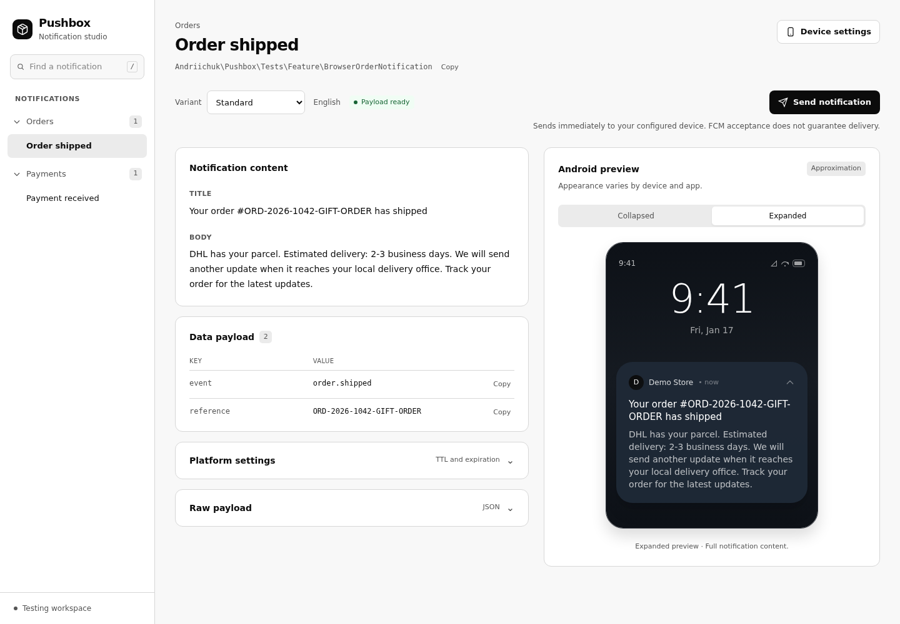

# Pushbox

[](https://github.com/andriichuk/pushbox/actions/workflows/run-tests.yml)
[](https://github.com/andriichuk/pushbox/actions/workflows/phpstan.yml)
[](https://packagist.org/packages/andriichuk/pushbox)

Preview Laravel FCM notification payloads, compare variants and translations, and send a deliberate test notification to your own device. Inspired by [Mailbook](https://github.com/Xammie/mailbook).



**This branch prepares the next major release (2.0).** The published 1.x package has different behavior. This version supports **PHP 8.4/8.5 and Laravel 12/13**. The optional real-send integration supports **laravel-notification-channels/fcm 6.2+ (6.x)**. Laravel 11 support has been removed.

## Install and preview

In a configured Laravel application with working sessions:

```bash
composer require --dev andriichuk/pushbox
php artisan pushbox:install
```

Until 2.0 is tagged, use the unreleased branch to test these changes (`dev-main` after merge). Laravel discovers the service provider automatically. The installer creates `routes/pushbox.php` and never overwrites existing registrations. Opening `/pushbox` before registering anything shows setup instructions.

For real `FcmMessage` payloads, install the optional channel:

```bash
composer require laravel-notification-channels/fcm:^6.2
php artisan make:notification WelcomePush
```

A complete notification, in `app/Notifications/WelcomePush.php`:

```php
<?php

namespace App\Notifications;

use Illuminate\Notifications\Notification;
use NotificationChannels\Fcm\FcmChannel;
use NotificationChannels\Fcm\FcmMessage;
use NotificationChannels\Fcm\Resources\Notification as FcmNotification;

class WelcomePush extends Notification
{
    public function via(object $notifiable): array
    {
        return [FcmChannel::class];
    }

    public function toFcm(object $notifiable): FcmMessage
    {
        return new FcmMessage(
            notification: new FcmNotification(
                title: __('Welcome'),
                body: 'Hello '.($notifiable->name ?? 'developer').'!',
            ),
            data: ['screen' => 'welcome'], // FCM data values must be strings.
        );
    }
}
```

Register it in `routes/pushbox.php`:

```php
use Andriichuk\Pushbox\Facades\Pushbox;
use App\Notifications\WelcomePush;

Pushbox::add(WelcomePush::class);
```

Run the application locally and open `/pushbox`. Previewing calls `toFcm()` and serializes its result; Pushbox makes no Firebase request during preview. Your own factories and notification methods can still have side effects. The package can also preview objects exposing `toArray()` without installing the FCM driver.

The Android preview is a visual approximation. It shows a thumbnail for collapsed notifications and a larger image when expanded, when the payload includes an image. Actual rendering, foreground behavior, permissions, and data-only messages depend on the client application and OS.

## Recipients, categories, variants, and translations

If your notification needs a User, register one explicitly. The original recipient, including its PHP type, is used for payload content in both preview and test sending:

```php
use App\Models\User;

Pushbox::to(User::factory()->make(['name' => 'Ada']))
    ->category('Onboarding')
    ->group(function () {
        Pushbox::add(WelcomePush::class)
            ->variant('Another greeting', fn (): WelcomePush => new WelcomePush);
    });
```

Factories must declare their concrete Notification return type. Use variants for multiple examples of the same notification class; selection is by class and variant. An unknown variant produces a diagnostic instead of silently sending the default. Nested groups restore their outer context, including after an exception.

```php
// config/pushbox.php
'locales' => ['en' => 'English', 'uk' => 'Ukrainian'],
```

The selected locale applies during notification construction and `toFcm()` in both preview and sending. The previous application locale is restored afterward. Unsupported locale selections fall back to `app.locale`.

Optional configuration publication:

```bash
php artisan vendor:publish --tag=pushbox-config
```

Set `PUSHBOX_DATABASE_ROLLBACK=true` to wrap preview factory resolution and `toFcm()` in a transaction on the **default database connection**. Writes on other connections, registration-file side effects, HTTP calls, mail, jobs, and real test sends are not rolled back. Prefer `factory()->make()` and put unavoidable default-DB writes inside the registered closure.

## Send to a test device

1. Configure the Firebase Admin SDK using the channel's [installation instructions](https://github.com/laravel-notification-channels/fcm#installation). Usually this means setting `FIREBASE_CREDENTIALS` to an absolute service-account JSON path outside the public directory. Keep credentials out of Git. Use a dedicated test Firebase project.
2. Obtain an FCM registration token from your test client (for example Firebase Messaging's `getToken()` on Android or Web, or `Messaging.messaging().token` on Apple platforms). The device token and service account must belong to the same Firebase project. Apple delivery also requires the project's APNs configuration and device permissions.
3. Set `PUSHBOX_ALLOW_SEND=true` locally, open **Device settings**, paste the device token, and press **Save token**. Alternatively, set `PUSHBOX_FCM_TOKEN` as a default.
4. Press **Send notification** to send immediately to the saved device token, or the configured default when no token is saved.

Save and Clear never send. Sending uses the saved session token, then the configured default; it never changes a User's stored production token. Clearing a saved token reveals the configured default. A stale page cannot send to a newly changed target without reviewing it again.

Test sends call the FCM channel synchronously without dispatching queue jobs, regardless of `via()` or `ShouldQueue` on your application notification. Pushbox wraps the notification to preserve its recipient-dependent content while routing delivery to the test device. Its `shouldSend()` veto is respected. Application notification events for a test send refer to this wrapper. Pushbox does not invoke other channels.

Reports distinguish **accepted**, **failed**, and **skipped**. FCM acceptance does not guarantee receipt. Structured reports include provider message IDs where available and mask the test token. Logs use `pushbox.accepted`, `pushbox.failed`, or `pushbox.skipped`; they do not contain the raw token.

If delivery fails:

- **Driver missing:** install FCM 6.2+; previews still work without it.
- **Credentials/project mismatch:** verify the configured Firebase project and service account.
- **Invalid/unregistered token:** obtain a fresh token from the intended device.
- **Accepted, no display:** check client permissions, foreground handlers, APNs setup, and whether the message is data-only.
- **Skipped:** check the notification's `shouldSend()` condition and application notification event listeners.
- **419:** restore the application's sessions/CSRF configuration. **429:** test sends are limited to 10 per minute per IP.

## Local and staging access

Default routes are available only in `local` and `testing`, with an additional request-time check that also protects cached routes. `PUSHBOX_ENABLED=false` disables access. Ship the package in `require-dev`; a production `composer install --no-dev` omits it.

Staging requires explicit configuration:

```dotenv
PUSHBOX_LOCAL_ONLY=false
PUSHBOX_SEND_NON_LOCAL=true
PUSHBOX_ALLOW_SEND=true
PUSHBOX_ALLOWED_IPS=203.0.113.10
```

It also requires an authorization Gate in your application's service provider. Keep your real environment name; define the gate using your application's actual access policy:

```php
use App\Models\User;
use Illuminate\Support\Facades\Gate;

Gate::define('viewPushbox', function (?User $user): bool {
    // Replace this with your project's authorization policy.
    return $user !== null && $user->can('use-developer-tools');
});
```

Outside local/testing, an undefined or denied `viewPushbox` Gate denies all preview, token, and send routes. The optional IP allowlist adds a restriction; it does not replace authorization. Configure Laravel's trusted proxies correctly when using an IP allowlist or rate limits.

`pushbox.path` changes the route prefix, and `pushbox.middleware` can add your app's authentication middleware. Rebuild route/config caches in the deployment's intended environment. Do not copy a locally generated configuration cache into production: Laravel's cached `app.env` determines its environment.

UI CSS and JavaScript are bundled, so viewing Pushbox needs no CDN, external fonts, asset publication, or Node installation. Payload images may still load their own URLs.

## Development and release checks

```bash
composer install
composer test
composer analyse
composer lint:check
composer audit
npm ci --ignore-scripts
npm run build
npx playwright install chromium
npm test
```

Commit the generated `resources/dist/pushbox.css`. CI checks PHP 8.4/8.5 with Laravel 12/13, lowest security-allowed and stable dependencies, a Windows lane, operation without FCM, browser interactions, static analysis, formatting, and dependency audits. Dependency changes require review; no workflow auto-merges or writes directly to main.

See [the release checklist](docs/RELEASING.md) for fresh-app, package archive, production-install, and real-device validation. Do not overwrite the existing `v1.0.0` tag.

## License

[MIT](LICENSE.md).
